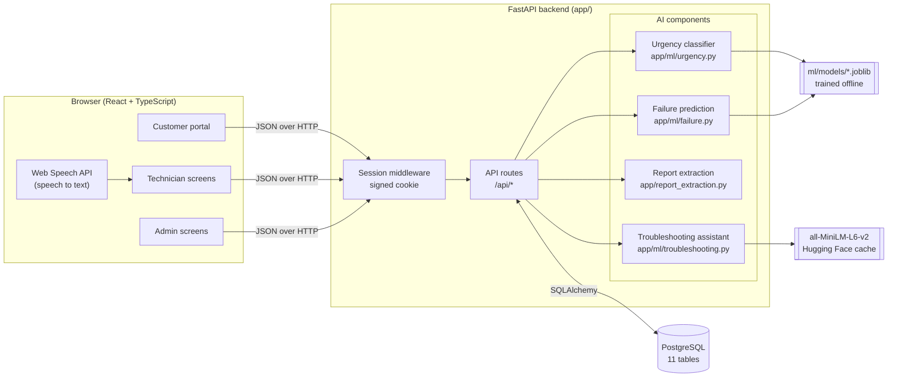
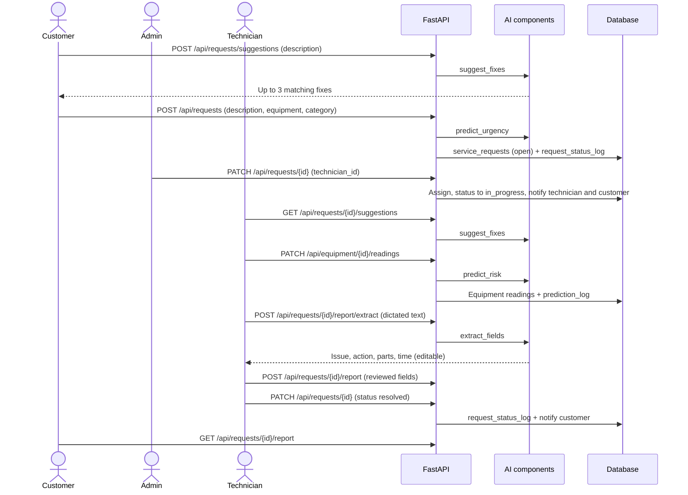
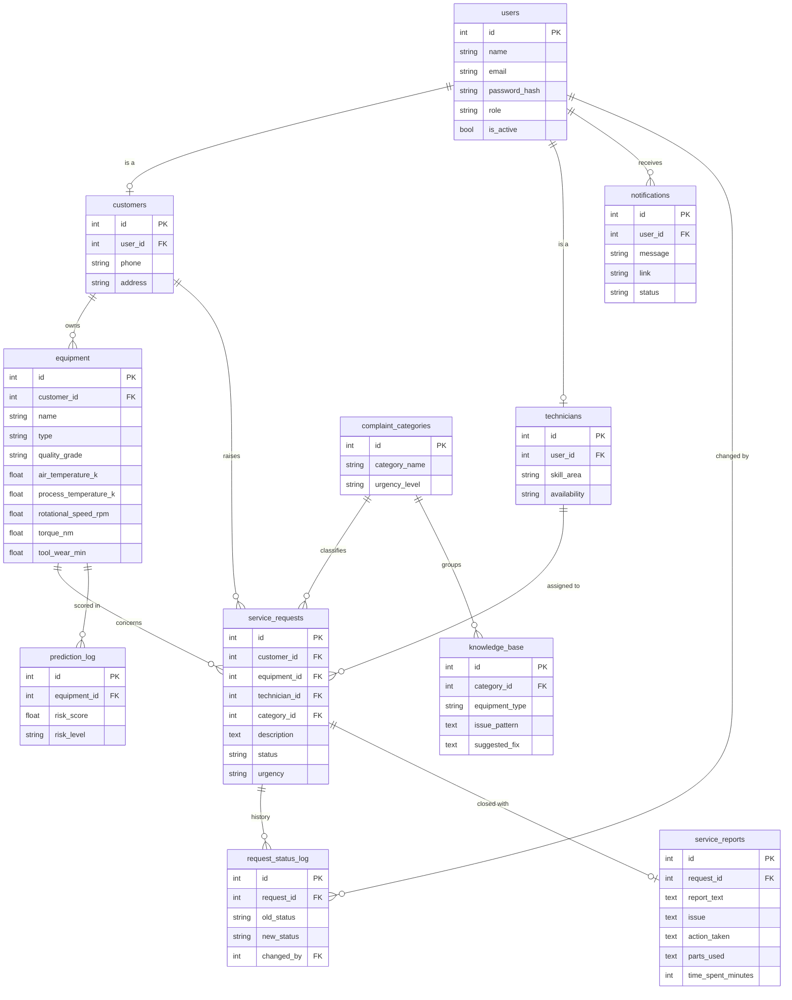

# System architecture

This document describes how the application is built: its parts, its data, its API and how the
four AI components fit in. Setup and running instructions are in the [README](../README.md);
measured model performance is in [evaluation.md](evaluation.md).

## 1. Users and roles

| Role | Signs up how | Main tasks |
|---|---|---|
| Customer | Self-registers on the customer portal (phone number + password) | Register equipment, raise complaints, try suggested quick fixes, track requests, read service reports |
| Technician | Created by an admin | See assigned jobs, raise requests for customers, update status, view suggested fixes, record sensor readings, dictate service reports |
| Admin | Created with `scripts/create_user.py`, or by another admin | Raise requests for customers, assign technicians, manage staff accounts, maintain the knowledge base, watch failure predictions, review analytics |

## 2. Components

- **Frontend** (`frontend/`): a single-page React app built with Vite, Tailwind CSS and shadcn/ui.
  In development Vite serves it on port 5180 and forwards `/api` to the backend; for a demo,
  `npm run build` produces `frontend/dist/`, which FastAPI serves itself.
- **Backend** (`app/`): a FastAPI JSON API. Every route lives in `app/routes/`; table definitions
  are in `app/models.py` and request/response shapes in `app/schemas.py`.
- **Database**: PostgreSQL, with every schema change made through an Alembic migration in
  `alembic/versions/`. Complaint categories and the knowledge base are seeded by migrations.
- **Offline training** (`ml/`): scripts that train the two scikit-learn models from public
  datasets and save them to `ml/models/`. The backend only loads the saved files.

## 3. AI components

| Component | Technique | Trained on | Runs when | Fallback if unavailable |
|---|---|---|---|---|
| Urgency classifier | TF-IDF + logistic regression | 16,338 English customer-support tickets | A customer submits a complaint | Medium urgency |
| Troubleshooting assistant | Sentence embeddings (all-MiniLM-L6-v2) + cosine similarity, 0.35 cut-off | No training; matches against the knowledge base | Customer clicks "Check for a quick fix"; technician or admin opens a request | No suggestions shown |
| Report extraction | Rule-based patterns | No training (no suitable dataset exists) | Technician dictates or types a report | Technician fills the fields by hand |
| Failure prediction | Random forest, balanced class weights | AI4I 2020 predictive-maintenance data, 10,000 readings | A technician records sensor readings | Moderate risk (never "good") |

Every AI output is advisory: urgency only orders the admin's queue, suggestions are optional,
extracted report fields are reviewed before saving, and a risk level prompts an inspection rather
than taking any action automatically. Every fallback is a safe default, so a missing model file
never stops a request or report from being saved.

## 4. Main workflows

### 4.1 Complaint to resolution

A request's status only moves forward (open, then in progress, then resolved), and every change is
written to `request_status_log` with who made it.

### 4.2 Notifications

Assigning a technician notifies both the technician and the customer; every status change notifies
the customer. The header bell polls `GET /api/notifications/unread-count` every 30 seconds and
lists recent notifications; clicking one marks it read and follows its link.

## 5. Data model

Enumerated columns (role, status, urgency, risk level and so on) are enforced with database CHECK
constraints as well as in the API. The equipment sensor columns use exactly the AI4I 2020
dataset's features, so a technician's reading can be scored by the failure model unchanged.

## 6. API reference

Interactive documentation for every endpoint is served at `/api/docs`. Summary:

| Method and path | Who | Purpose |
|---|---|---|
| `POST /api/auth/register` | Public | Customer sign-up |
| `POST /api/auth/login` | Public | Log in by phone or email |
| `POST /api/auth/logout` | Any | End the session |
| `GET /api/auth/me` | Any | Current user |
| `GET /api/overview/{admin,customer,technician}` | Matching role | Dashboard figures |
| `GET /api/analytics` | Admin | 30-day request trend; requests by status, urgency and category; technician workload and resolution times; equipment risk |
| `GET /api/equipment` | Customer | Own equipment, with latest risk |
| `POST /api/equipment` | Customer | Register equipment |
| `GET /api/equipment/all` | Admin | All equipment, with latest risk |
| `PATCH /api/equipment/{id}/readings` | Admin, assigned technician | Record readings and score failure risk |
| `POST /api/requests` | Customer, admin, technician | Raise a complaint (urgency predicted). Staff raise one on a customer's behalf; a technician's is assigned to them |
| `GET /api/requests/mine` | Customer | Own requests |
| `GET /api/requests/assigned` | Technician | Assigned jobs, active first |
| `GET /api/requests` | Admin | All requests |
| `PATCH /api/requests/{id}` | Admin (assign), technician (status) | Assign a technician or move status forward |
| `GET /api/requests/technicians` | Admin | Active technicians to assign |
| `GET /api/requests/customers` | Admin, technician | Active customers and their equipment, to raise a request for |
| `GET /api/requests/categories` | Any | Complaint categories |
| `POST /api/requests/suggestions` | Any | Quick-fix suggestions for a draft complaint |
| `GET /api/requests/{id}/suggestions` | Admin, assigned technician | Suggestions for a request |
| `POST /api/requests/{id}/report/extract` | Admin, assigned technician | Preview extracted report fields (nothing saved) |
| `POST /api/requests/{id}/report` | Admin, assigned technician | Save the service report |
| `GET /api/requests/{id}/report` | Admin, assigned technician, owning customer | Read the service report |
| `GET /api/users` | Admin | All user accounts |
| `POST /api/users` | Admin | Create a technician or admin |
| `PATCH /api/users/{id}/active` | Admin | Activate or deactivate any account except their own |
| `GET /api/knowledge-base` | Admin | List entries |
| `POST /api/knowledge-base` | Admin | Add an entry |
| `PATCH /api/knowledge-base/{id}` | Admin | Edit an entry |
| `DELETE /api/knowledge-base/{id}` | Admin | Delete an entry |
| `GET /api/notifications` | Any | Own notifications, newest first |
| `GET /api/notifications/unread-count` | Any | Unread badge count |
| `PATCH /api/notifications/{id}/read` | Any (own only) | Mark one read |
| `POST /api/notifications/read-all` | Any | Mark all read |

## 7. Security

- **Passwords** are hashed with bcrypt. A failed login for an unknown account still checks a dummy
  hash, so response time doesn't reveal whether an account exists.
- **Sessions** are a signed, `SameSite=Lax` cookie holding only the user id. The user's role and
  active flag are re-read from the database on every request, so deactivating an account or
  changing a role takes effect immediately. The session is cleared and recreated on login.
- **Authorisation** is checked per route with `require_role`, and per record: technicians can
  only touch requests and equipment they've been assigned, customers only their own.
- **Registration** always creates a customer; staff accounts can only be created by an admin.
- **API responses** are sent with `Cache-Control: no-store` so account data isn't left in the
  browser cache after logout.
