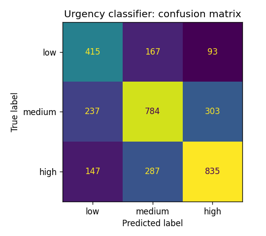
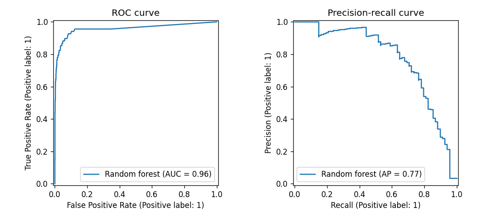
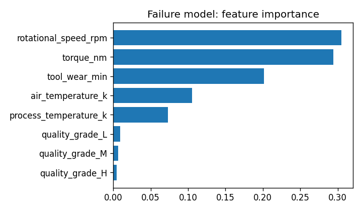
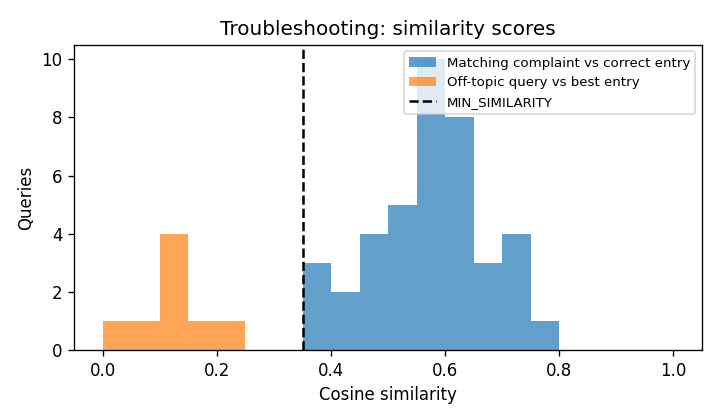

# Evaluation results

Generated by `python ml/evaluate.py`; do not edit by hand. See `docs/evaluation.md` for discussion.

## 1. Urgency classifier

TF-IDF + logistic regression, 13,070 training / 3,268 held-out English tickets.

| Model | Accuracy | Macro F1 |
|---|---|---|
| Majority-class baseline | 40.5% | 0.192 |
| Urgency classifier | 62.2% | 0.614 |

Recall on **high** urgency: 65.8%.

```
              precision    recall  f1-score   support

         low      0.519     0.615     0.563       675
      medium      0.633     0.592     0.612      1324
        high      0.678     0.658     0.668      1269

    accuracy                          0.622      3268
   macro avg      0.610     0.622     0.614      3268
weighted avg      0.627     0.622     0.624      3268
```



## 2. Failure prediction

Random forest, 2,000 held-out readings (68 real failures).

- ROC-AUC: **0.958**
- Average precision (PR-AUC): **0.774** (a random model scores 0.034)

Recall and precision of the *failure* class if every reading at or above the threshold is flagged:

| Threshold | Recall | Precision | Readings flagged |
|---|---|---|---|
| 0.08 (app: moderate) | 88.2% | 36.6% | 8.2% |
| 0.15 | 82.4% | 52.3% | 5.3% |
| 0.25 (app: critical) | 75.0% | 68.9% | 3.7% |
| 0.35 | 63.2% | 81.1% | 2.6% |
| 0.50 | 47.1% | 91.4% | 1.8% |

How the app's three risk levels split the test set:

| Risk level | Real failures | No failure |
|---|---|---|
| good | 8 | 1828 |
| moderate | 9 | 81 |
| critical | 51 | 23 |




## 3. Troubleshooting assistant

40 hand-written complaints against the 20 seeded knowledge-base entries, plus 8 off-topic queries.

| Method | Top-1 | Top-3 | MRR |
|---|---|---|---|
| Keyword baseline (TF-IDF) | 77.5% | 92.5% | 0.860 |
| Semantic search (all-MiniLM-L6-v2) | 90.0% | 100.0% | 0.950 |

With the app's MIN_SIMILARITY = 0.35 cut-off:

- Complaints that get at least one suggestion: 100.0%
- Complaints whose correct fix is among the suggestions shown: 100.0%
- Off-topic queries correctly given no suggestion: 100.0%



## 4. Report extraction

12 hand-written technician reports with hand-labelled fields.

| Field | Score |
|---|---|
| Issue | 91.7% accuracy |
| Action taken | 100.0% accuracy |
| Time spent | 100.0% accuracy |
| Parts used | 100.0% precision, 88.9% recall |

Reports where the extracted issue misses the labelled cause:

- "Water dripping from the indoor AC unit. The condensate drain line was blocked. Flushed the drain line and fitted a new drain pan. 35 min." — expected "condensate drain line was blocked", extracted "Water dripping from the indoor AC unit."

Reports where the extracted parts differ from the labels:

- "Lathe was making a grinding noise. Found the spindle bearing was worn. Replaced the belt and the bearing, then realigned the spindle. Job took 3 hours." — expected ['belt', 'bearing'], extracted ['belt']
